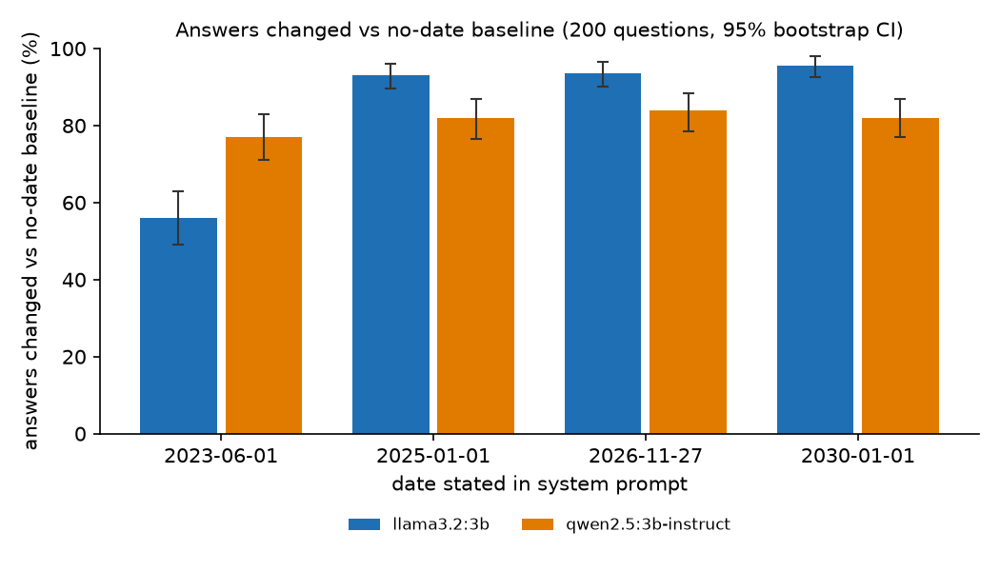

# prompt-date-drift

**Does the date in the system prompt change a small local model's answers?** This harness asks two
local Ollama models (`qwen2.5:3b-instruct`, `llama3.2:3b`) 200 synthetic date-arithmetic and "what is
current" questions. The only thing that changes between runs is the date stated in the system prompt:
none, 2023-06-01, 2025-01-01, 2026-11-27 or 2030-01-01. Every answer is parsed and scored in Python
against ground truth computed with `datetime` relative to the stated date.

The arXiv paper listed in the build spec (arXiv:2611.31254) motivated this repo. I don't reproduce
any of that paper's numbers here. Everything below was measured with the code in this repo.

## Headline result

**Answer flip rate:** the share of questions whose parsed answer changes between the no-date baseline
and a stated date, averaged over the 4 stated dates. The 95% CI comes from a 1000-sample paired
bootstrap over questions.

| model | mean flip rate vs no-date baseline [95% CI] |
|---|---|
| llama3.2:3b | **84.5%** [82.2, 86.5] |
| qwen2.5:3b-instruct | **81.2%** [76.2, 85.9] |

Measured on commit `2ca7bd0`. The raw responses were generated on commit `b5574e0` with the same
prompts, client and parser (each row of `results/results.jsonl` records its commit). To reproduce
these numbers from the committed responses without Ollama, run
`python score.py results/results.jsonl`.

What this means: saying what day it is changes more than 80% of the answers for both 3B models. The
date also helps. Accuracy goes from 4% with no date to 18–41% with a date. Even so, the models still
get most of these questions wrong.



### Full table (`make score`)

| model | system date | n | accuracy % [95% CI] | Δacc vs none (pp) [95% CI] | flip rate % [95% CI] | unparsed % |
|---|---|---:|---|---|---|---:|
| llama3.2:3b | none | 200 | 4.0 [1.5, 7.0] | — (baseline) | — (baseline) | 15.5 |
| llama3.2:3b | 2023-06-01 | 200 | 34.0 [27.0, 40.0] | +30.0 [+22.0, +37.0] | 56.0 [49.0, 63.0] | 0.0 |
| llama3.2:3b | 2025-01-01 | 200 | 26.0 [20.0, 32.0] | +22.0 [+15.0, +28.5] | 93.0 [89.5, 96.0] | 0.0 |
| llama3.2:3b | 2026-11-27 | 200 | 18.0 [13.0, 23.5] | +14.0 [+8.0, +20.0] | 93.5 [90.0, 96.5] | 0.0 |
| llama3.2:3b | 2030-01-01 | 200 | 22.0 [16.5, 28.0] | +18.0 [+11.5, +25.0] | 95.5 [92.5, 98.0] | 0.0 |
| qwen2.5:3b-instruct | none | 200 | 4.0 [1.5, 7.0] | — (baseline) | — (baseline) | 0.0 |
| qwen2.5:3b-instruct | 2023-06-01 | 200 | 30.5 [25.0, 37.0] | +26.5 [+20.0, +34.0] | 77.0 [71.0, 83.0] | 0.0 |
| qwen2.5:3b-instruct | 2025-01-01 | 200 | 26.5 [20.5, 32.5] | +22.5 [+15.5, +29.0] | 82.0 [76.5, 87.0] | 0.0 |
| qwen2.5:3b-instruct | 2026-11-27 | 200 | 41.0 [34.0, 48.0] | +37.0 [+30.5, +44.5] | 84.0 [78.5, 88.5] | 0.0 |
| qwen2.5:3b-instruct | 2030-01-01 | 200 | 34.0 [27.0, 40.5] | +30.0 [+22.5, +37.5] | 82.0 [77.0, 87.0] | 0.0 |

The `score.py` output also has a `truth-flip` column: how often the correct answer itself differs
from the 2026-11-27 truth. It is 100% for every stated date except 2026-11-27, where it is 0%.

### Per question kind (`make score`, point estimates)

| model | kind | flip 2023 | flip 2025 | flip 2026 | flip 2030 | acc none | acc 2023 | acc 2025 | acc 2026 | acc 2030 |
|---|---|---:|---:|---:|---:|---:|---:|---:|---:|---:|
| llama3.2:3b | age_in_year | 24 | 100 | 100 | 100 | 0 | 100 | 96 | 26 | 76 |
| llama3.2:3b | days_until | 94 | 100 | 90 | 96 | 0 | 0 | 0 | 0 | 0 |
| llama3.2:3b | weekday_of | 24 | 80 | 92 | 94 | 16 | 24 | 6 | 10 | 10 |
| llama3.2:3b | years_since | 82 | 92 | 92 | 92 | 0 | 12 | 2 | 36 | 2 |
| qwen2.5:3b-instruct | age_in_year | 88 | 100 | 100 | 100 | 0 | 74 | 68 | 86 | 98 |
| qwen2.5:3b-instruct | days_until | 100 | 100 | 100 | 100 | 0 | 2 | 0 | 0 | 0 |
| qwen2.5:3b-instruct | weekday_of | 38 | 38 | 40 | 30 | 16 | 12 | 12 | 10 | 12 |
| qwen2.5:3b-instruct | years_since | 82 | 90 | 96 | 98 | 0 | 34 | 26 | 68 | 26 |

### Observations

- **With no date given, the models seem to assume it is about 2022–2023.** Each `age_in_year` question
  asks how old someone born in year Y turns "this calendar year", so birth year + answer is the year
  the model assumes. With no date, llama's most common implied year is 2023 (38 of 50) and qwen's is
  2022 (13 of 50). This is why accuracy against the real run date (2026-11-27) is only 4% for both
  models. When a date is stated, the implied year mostly follows it. One exception: with 2026-11-27
  stated, llama answers as if it were 2027 in 37 of 50 cases.
- **llama refuses only when no date is given.** 15.5% of its no-date answers are refusals such as "I
  cannot provide a date that is in the future". It never refuses once a date is stated.
- **A high flip rate doesn't mean the models get the date right.** Both models score 0–2% on
  `days_until` at every date, but that kind still flips 90–100% of the time. Most of the headline is
  "the number changed", not "the number became correct". The `age_in_year` rows show where the date
  actually helps.
- **qwen's weekday answers barely respond to the date.** They flip 30–40% of the time and stay at
  10–16% accuracy, which is not much better than the 1-in-7 chance rate.

## How the experiment works

- **Questions** (`gen_questions.py`, seed 0, 4 kinds × 50):
  - `days_until`: days from today to a fixed date, negative if that date is in the past
  - `weekday_of`: the weekday today or N days from today
  - `age_in_year`: how old someone born in year Y turns this year
  - `years_since`: full years since a dated fictional event

  The ground truth is a function of the reference date (`datedrift/questions.py::truth`). Every item's
  truth changes across the five dates, and a test checks this.
- **Prompts:** the system prompt is `You are a helpful assistant.`, followed by
  `Today's date is YYYY-MM-DD.` unless the condition is "none". The user turn is the question plus
  "Reply with only the answer, as a single integer/weekday name."
- **Decoding:** temperature 0, seed 0, `num_predict 32`, `num_ctx 2048`, through the Ollama
  `/api/chat` endpoint.
- **Parsing** (`datedrift/parser.py`): the parser takes an explicit `Answer:` value first, then the
  last integer or weekday in the text. Anything it can't read is logged as *unparsed* and counted as
  wrong. A response pair counts as a flip if exactly one side is unparsed. If both sides are unparsed,
  it isn't a flip.
- **Scoring** (`datedrift/scoring.py`): `score.py` re-parses the raw responses and recomputes the
  truth, so a parser fix never needs new model calls.
  - Accuracy for the "none" cell is scored against the real run date, 2026-11-27. With no date
    given, there's no well-defined truth, so treat that cell as a convention.
  - The CIs are 95% percentile intervals from 1000 bootstrap resamples of the 200 questions (seed 0).
  - The bootstrap is paired: Δaccuracy, flip rate and the headline mean all use the same resampled
    questions for every date.

## Setup

You need Python 3.11, [uv](https://github.com/astral-sh/uv) and [Ollama](https://ollama.com).

```bash
make setup                 # creates .venv and installs the package with pytest
make pull                  # ollama pull qwen2.5:3b-instruct llama3.2:3b (about 4 GB)
source .venv/bin/activate
```

## Usage

```bash
python gen_questions.py --seed 0 | wc -l   # 200
make questions                             # writes data/questions.jsonl (gitignored)
make run                                   # sweep, writes results/results.jsonl (2000 rows)
make score                                 # tables, writes results/summary.json
make plot                                  # writes results/flip_rate.png
```

`run.py` caches every raw response in `results/cache.jsonl`, keyed by (model, system date, question
id). It also stores a hash of the exact request, so a changed prompt is queried again. This means the
sweep can resume after an interruption. `python run.py --max-seconds 540` stops cleanly after the time
budget, and running it again picks up where it left off. On the build machine (Apple M4, shared with
other work) the full sweep took about 18 minutes of model time, spread over three resumed chunks.

## Tests

```bash
pytest -q      # 42 tests, offline, no Ollama needed
```

- `tests/test_parser.py`: 26 hand-written model outputs, including refusals, `-1,046`, `112 días`,
  `**57**`, `Tue` and a unicode minus.
- `tests/test_questions_client.py`:
  - the generator produces 200 balanced questions
  - the same seed gives the same questions
  - hand-checked truths (e.g. 2026-11-27 → 2027-04-27 is 151 days)
  - the system prompt differs only by its date
  - the cache returns hits and is invalidated when the request changes
- `tests/test_score_fixture.py`: scores `tests/fixtures/cached_results.jsonl`, which has two fake
  models × 5 dates × 4 questions. The expected accuracy, flip rates, Δaccuracy, unparsed rate and
  headline mean (0.75 and 0.4375) were worked out by hand. The CI properties and the `score.py` CLI
  table are tested too. `tests/make_fixture.py` regenerates the fixture.

## Limitations

- **The questions are synthetic.** This is a probe of 200 templated questions, not a claim about any
  benchmark or about real-world use.
- **Only two small models, each with one prompt template and one phrasing of the date.** The results
  may not hold for larger models, other date formats, or dates given in the user turn.
- **Answers are direct, with no reasoning.** I first tried letting the models reason step by step with
  a 384-token budget, but the shared machine only ran at about 5 tokens/s. At that speed, 2000
  reasoning-length answers wouldn't have been practical, so the prompt asks for only the answer.
  Accuracy with reasoning would probably be higher, especially on `days_until`, which is near 0%
  here.
- **Flip rate measures sensitivity, not correctness.** On integer answers with a wide range, almost
  any noise counts as a flip. Read it together with Δaccuracy and the per-kind table.
- **The "none" accuracy baseline is a convention.** It's scored against the date of the run.
- **Results come from a single run.** Temperature 0 with a fixed seed is deterministic in practice
  for a given Ollama build and machine, but the exact numbers may change with other Ollama versions
  or hardware.
- **The CIs only reflect sampling over questions.** They don't cover variation from model versions
  or prompt wording.

## Licence

MIT.
